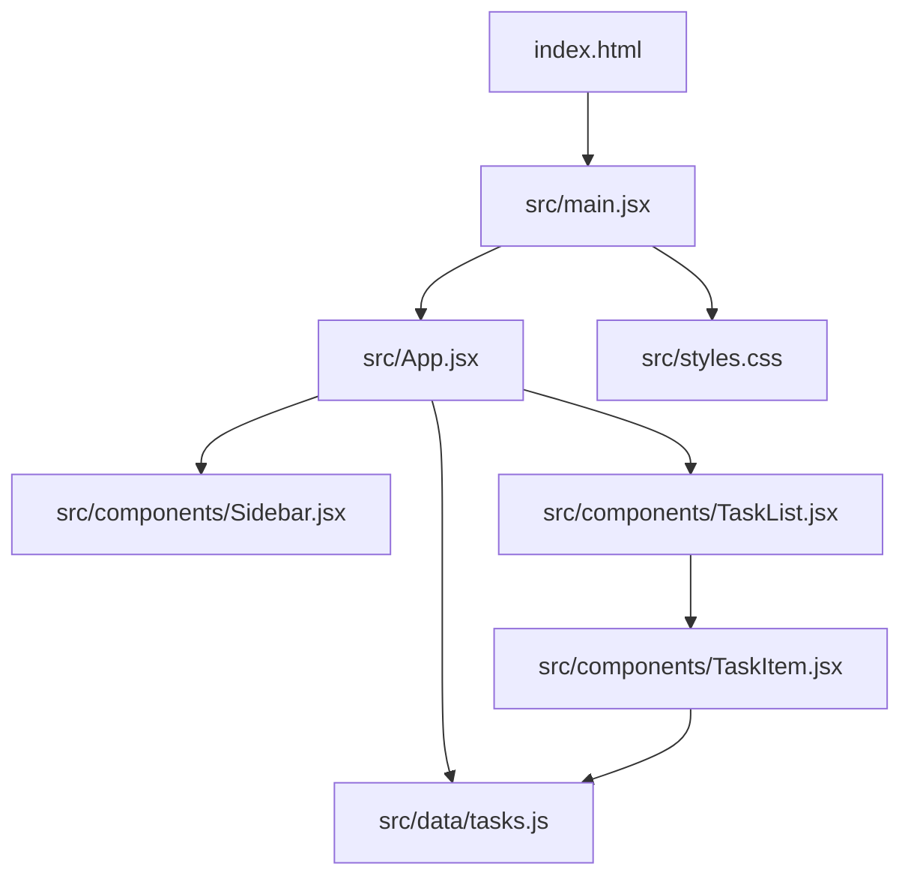

# Meu dia — Atividade React

Aplicação simples de organização de tarefas, feita com React e Vite. O projeto demonstra JSX, componentes, props, listas, renderização condicional e a atualização da interface pelo Virtual DOM.

## Funcionalidades

- Visualizar tarefas de exemplo e seus totais.
- Adicionar uma tarefa, marcar como concluída e removê-la.
- Filtrar a lista por todas, tarefas a fazer ou concluídas.
- Exibir uma mensagem contextual quando o filtro não encontra tarefas.
- Adaptar a interface a telas menores.

## Conceitos React utilizados

- **JSX:** estrutura das telas escrita junto à lógica dos componentes.
- **Componentes:** `App`, `Sidebar`, `TaskList` e `TaskItem` dividem a interface em partes reutilizáveis.
- **Props:** tarefas, contadores e funções são passados aos componentes filhos.
- **Estado:** `useState` mantém tarefas, filtro e texto do formulário.
- **Listas:** `map()` cria os itens e cada tarefa usa `id` como chave.
- **Renderização condicional:** filtro selecionado, estilos de conclusão e estado vazio variam conforme os dados.
- **Virtual DOM:** ao mudar o estado, o React compara a nova árvore de elementos com a anterior e atualiza no DOM apenas o necessário.

## Executar localmente

Requisitos: Node.js e npm.

```bash
npm install
npm run dev
```

Para gerar a versão de produção:

```bash
npm run build
npm run preview
```

## Estrutura do projeto



## Sugestões de commits

O padrão [Conventional Commits](https://www.conventionalcommits.org/) deixa o histórico consistente:

```text
chore: inicializa projeto React com Vite
feat: adiciona lista interativa de tarefas
feat: inclui filtros e resumo de tarefas
docs: documenta conceitos React e estrutura do projeto
style: cria layout responsivo para a aplicação
```

## Publicação no GitHub

Crie um repositório público no GitHub e conecte-o ao projeto local:

```bash
git init
git add .
git commit -m "chore: inicializa atividade React"
git branch -M main
git remote add origin URL_DO_REPOSITORIO
git push -u origin main
```
